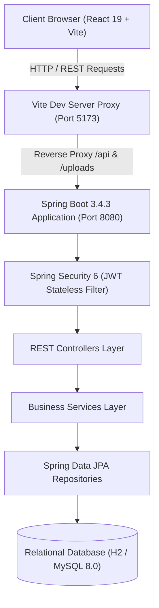

# 🎓 LearnHub — Full-Stack Online Learning & Skills Platform
> **Final-Year Computer Science Engineering Capstone Project**  
> Modern, production-grade E-Learning system built with Java 17, Spring Boot 3, Spring Security 6, JWT, Hibernate/JPA, and React 19.

---

## 🌟 Executive Overview
**LearnHub** is an enterprise-grade full-stack online learning platform engineered to address real-world education delivery challenges. It provides role-based interfaces tailored for **Students**, **Instructors**, and **Administrators**, featuring video streaming, curriculum progression tracking, server-side anti-cheat quiz grading, and cryptographically verifiable digital certificates.

---

## 🏛️ System Architecture



---

## 💻 Technology Stack

| Layer | Technologies |
| :--- | :--- |
| **Frontend** | React 19, Vite 8, React Router v7, Axios, Lucide Icons, Canvas Confetti |
| **Frontend Styling** | Custom Dark Glassmorphism Design System (CSS3 Variables & Tokens) |
| **Backend Framework** | Java 17, Spring Boot 3.4.3 |
| **Security & Auth** | Spring Security 6, JJWT 0.12.6 (HMAC-SHA256), BCrypt (10 rounds) |
| **ORM & Database** | Spring Data JPA, Hibernate ORM 6.6, H2 Database / MySQL 8.0 Connector |
| **Build Tools** | Maven 3 (via Maven Wrapper `mvnw`), Node.js & npm |

---

## 👥 Role-Based Portals & Pre-Seeded Credentials

LearnHub comes pre-seeded with complete sample curriculum, quizzes, and three demo accounts:

| Role | Email | Password | Access Rights |
| :--- | :--- | :--- | :--- |
| **🛡️ Admin** | `admin@learnhub.com` | `Admin@123` | Platform analytics, category management, course approval/rejection, user overview |
| **👨‍🏫 Instructor** | `john.instructor@learnhub.com` | `Instructor@123` | Course creation, curriculum design (sections/lessons), quiz creation, student enrollments tracking |
| **🎓 Student** | `alice.student@learnhub.com` | `Student@123` | Browse catalog, course enrollment, video player, progress tracking, quiz taking, certificate issuance |

> **Tip**: The login screen features **1-Click Demo Login** buttons for instant testing of each role without typing credentials!

---

## 🚀 Quick Start Guide

### Prerequisites
- **Java 17+** (Adoptium / Eclipse Temurin recommended)
- **Node.js 18+** & npm

### Running the Backend
```powershell
cd M:\LearnHub\backend
.\mvnw.cmd spring-boot:run
```
*Backend runs on: `http://localhost:8080`*  
*H2 Interactive Console: `http://localhost:8080/h2-console` (JDBC URL: `jdbc:h2:file:./data/learnhub_db`, User: `sa`, Password: `<empty>`)*

### Running the Frontend
```powershell
cd M:\LearnHub\frontend
npm install
npm run dev
```
*Frontend runs on: `http://localhost:5173`*

---

## 📚 Key Features & Academic Viva Highlights

1. **Decoupled Architecture**: Separation of concerns between a stateless React Single Page Application (SPA) and RESTful Spring Boot micro-services.
2. **Stateless JWT Security**: Secure cryptographic authentication using HMAC-SHA256 tokens (`Bearer <token>`). Tokens expire after 24 hours. Passwords hashed using standard BCrypt algorithm with salting.
3. **Anti-Cheat Server-Side Quiz Grading**: Quizzes never expose correct answer keys to the client browser. Answers are submitted to `/api/quizzes/{id}/submit` where the server calculates scores, enforces passing threshold (70%), and stores quiz attempts with timestamps.
4. **Automated Certificate Generation**: Upon completing 100% of course lessons, the platform automatically issues a unique certificate code (e.g. `LH-1-3-4089B42E`). Anyone can verify authenticity publicly at `/verify`.
5. **Entity Graph Performance Optimization**: Spring Data JPA `@EntityGraph` and custom DTO mapping prevent `LazyInitializationException` and N+1 query performance degradation.
6. **Dual Database Support**:
   - Zero-config disk-persistent **H2 Database** (`./data/learnhub_db`) out of the box.
   - Production **MySQL 8.0** support via `--spring.profiles.active=mysql`.

---

## 📡 REST API Catalog Overview

### Authentication (`/api/auth`)
- `POST /api/auth/register` — Register new Student or Instructor
- `POST /api/auth/login` — Authenticate and receive JWT token
- `GET /api/auth/me` — Retrieve current authenticated user profile

### Courses (`/api/courses`)
- `GET /api/courses` — Paginated search, category filter, level filter
- `GET /api/courses/{id}` — Full course details including sections, lessons, and quizzes
- `POST /api/courses` — Create new course *(Instructor/Admin only)*
- `PUT /api/courses/{id}` — Update course details *(Instructor/Admin only)*
- `DELETE /api/courses/{id}` — Remove course *(Instructor/Admin only)*

### Learning & Progress (`/api/lessons`)
- `GET /api/lessons/{id}` — Fetch lesson metadata and content
- `POST /api/lessons/{id}/progress` — Update watch position and toggle completion status

### Quizzes (`/api/quizzes`)
- `GET /api/quizzes/{id}` — Fetch quiz questions (without revealing answer keys)
- `POST /api/quizzes/{id}/submit` — Grade quiz answers and record attempt

### Certificates (`/api/certificates`)
- `GET /api/certificates/my-certificates` — List student certificates
- `GET /api/certificates/verify/{code}` — Public verification of certificate authenticity

### Admin Dashboard (`/api/admin`)
- `GET /api/admin/stats` — Platform counters (students, instructors, courses, quizzes, certificates)
- `PATCH /api/admin/courses/{id}/approve` — Approve pending instructor course
- `PATCH /api/admin/courses/{id}/reject` — Reject course with feedback message
- `GET /api/admin/users` — User administration
- `POST /api/admin/categories` — Create course category

---

## 📄 License & Attribution
Designed and implemented as a Final-Year Computer Science & Engineering Capstone Project.
